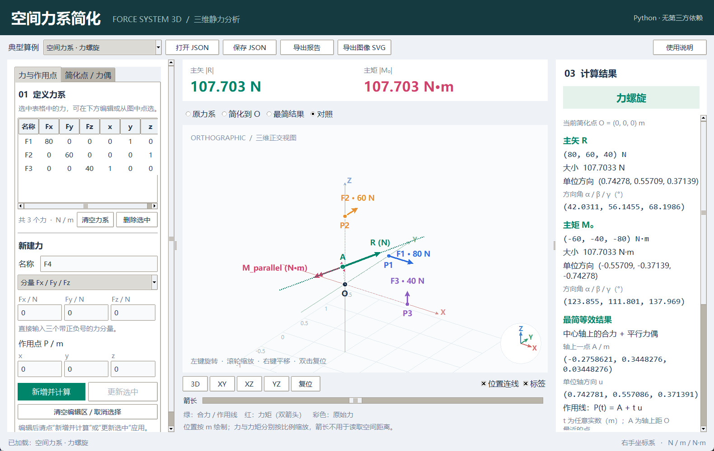

# 空间任意力系简化 · Python 3D 交互程序

输入各力的大小、方向和作用点，以及任意简化点，计算主矢、主矩与最简等效力系。界面使用 Python 标准库 `tkinter` 绘制可旋转的三维场景，无需安装 NumPy、Matplotlib 或其他第三方包。



## 运行

建议使用 Python 3.10 或更高版本，并安装其 Tcl/Tk 组件。Windows 官方 Python 安装程序通常包含该组件。

```powershell
cd force_system_3d
python app.py
```

通过 GitHub 克隆时，可执行：

```powershell
git clone https://github.com/Monkey-cmd/force-system-3d.git
cd force-system-3d
python app.py
```

Windows 也可以双击 `launch.bat`。启动脚本优先使用 `py -3`，找不到时使用 `python`。若提示找不到 `tkinter`，请在 Python 安装程序中启用 Tcl/Tk；它不是需要通过 `pip` 安装的第三方包。

无需图形界面也可从 JSON 文件生成文本报告：

```powershell
python app.py --input examples/01_wrench.json --report report.txt
```

报告文件名可自行指定。文件路径含空格时，请用双引号括起来。

## 使用界面

1. 在左栏的**力与作用点**页签中填写名称、作用点和方向信息。支持三种输入方式：
   - **分量**：直接填写 `Fx, Fy, Fz`，分量可以是负数。
   - **大小 + 方向向量**：填写非负大小 `F` 和方向向量 `dx, dy, dz`。程序自动归一化方向向量，无需先换算为方向余弦。非零力不能使用零方向向量。
   - **方位角 / 仰角**：填写大小、方位角与仰角，角度单位为度。方位角从 `+x` 轴向 `+y` 轴为正；仰角从 `xy` 平面向 `+z` 为正，范围为 `[-90°, 90°]`。
2. 点击**新增并计算**将新力加入列表并计算；从表格或三维图中选中已有力后，修改参数并点击**更新选中**。点击**清空编辑区 / 取消选择**可重新填写新力；**删除选中**移除当前选中的力，**清空力系**移除全部力。
3. 切换到左栏的**简化点 / 力偶**页签，填写简化点 `O=(Ox, Oy, Oz)` 和附加自由力偶矩 `C=(Cx, Cy, Cz)`，点击**应用简化点 / 力偶**后重新计算。没有自由力偶时令 `C=(0,0,0)`。参数有改动而尚未应用时，页签中会显示提示。
4. 查看主矢、主矩的分量、大小、单位方向向量，以及与三个正坐标轴的方向角；查看最简结果及作用线 / 中心轴。
5. 可加载内置算例，或使用 JSON 保存、加载当前力系；可导出 TXT 计算报告和当前视角的 SVG 场景。

三维场景操作：**左键拖动旋转，滚轮缩放，右键拖动平移，双击复位视角**。箭头表示矢量方向；图形为帮助理解而设置绘制比例，请以结果区的数值与单位为准。SVG 保存的是当前三维场景的二维投影，可在浏览器中打开。

## 坐标、单位与输入约定

- 采用右手直角坐标系，力矩正向按右手定则确定；`r × F` 的顺序不能颠倒。
- 力以 `N`、坐标以 `m`、力矩以 `N·m`、螺距以 `m` 输入和输出。输入前应统一单位，例如 `100 mm = 0.1 m`。程序不自动混用或换算单位。
- 支持有限实数和科学计数法。`NaN`、无穷大、负的力大小、非零力的零方向向量均不作为有效输入。
- 力的作用点与简化点均使用同一全局坐标系。力是可沿作用线滑移的定位矢量；自由力偶矩与作用点无关。
- 零向量没有唯一方向，程序显示“方向未定义”，不人为指定其方向角。沿 `z` 轴时方位角也未定义。

## 计算原理与四种最简结果

对第 `i` 个力，设作用点为 `P_i`、分量向量为 `F_i`，简化点为 `O`，附加自由力偶矩为 `C`：

```text
R   = Σ F_i
M_O = Σ [(P_i - O) × F_i] + C
|v| = sqrt(vx² + vy² + vz²)
u_v = v / |v|                         （v 非零时）
α = acos(vx/|v|), β = acos(vy/|v|), γ = acos(vz/|v|)
```

主矢 `R` 与简化点无关，主矩 `M_O` 随简化点改变。对非零主矢，定义：

```text
u          = R / |R|
A          = O + (R × M_O) / |R|²
M_parallel = (M_O · u) u
h          = (R · M_O) / |R|²
P(t)       = A + t u,  t ∈ R
```

`A` 是中心轴上离 `O` 最近的点；`u` 是轴的单位方向向量。参数 `t` 的单位为 `m`。`h` 是带符号的螺距；正值表示剩余力偶与主矢同向，负值表示反向。`M_parallel = h R`。

| 条件（考虑数值容差） | 最简结果 | 需要给出的定位信息 |
|---|---|---|
| `R=0`，`M_O=0` | 平衡力系 / 零力系 | 无 |
| `R=0`，`M_O≠0` | 纯力偶，力偶矩为 `M_O` | 自由矢量，无固定作用点或作用线 |
| `R≠0`，`M_parallel=0` | 单一合力 `R` | 作用线 `P(t)=A+t u` |
| `R≠0`，`M_parallel≠0` | 力螺旋：轴上的合力 `R` 加平行自由力偶 `M_parallel` | 中心轴 `P(t)=A+t u` |

因此，一般空间力系不一定能仅用一个力代替；剩余轴向力偶非零时，需要保留力螺旋。最简结果保持原力系对刚体的外部静力效应。

### 浮点容差

默认相对容差为 `1e-10`，力绝对容差为 `1e-12 N`，矩绝对容差为 `1e-12 N·m`。各物理量单独计算阈值：

```text
力阈值 = 1e-12 N + 1e-10 × Σ|F_i|
矩阈值 = 1e-12 N·m + 1e-10 × (Σ|(P_i-G)×F_i| + |C|)
```

其中 `G` 为各作用点的算术平均点；没有力时取 `G=O`。这种矩尺度减少仅更换简化点导致分类变化的情况。容差用于判定是否近似为零，原始主矢、主矩仍保留浮点计算值。接近阈值的力系应结合输入精度理解。报告还给出由最简结果重构原主矢、主矩的残差，便于核对等效性。

## 内置算例与手算校验

| 文件 | 情形 | 预期分类 |
|---|---|---|
| `examples/01_wrench.json` | 三个异面空间力 | 力螺旋 |
| `examples/02_parallel_resultant.json` | 两个同向平行力 | 单一合力 |
| `examples/03_couple.json` | 等大反向、不同作用线 | 纯力偶 |
| `examples/04_concurrent.json` | 三个共点力，简化点取交点 | 单一合力 |
| `examples/05_equilibrium.json` | 两个共线等大反向力 | 平衡力系 |
| `examples/06_negative_pitch.json` | 轴向力及反向自由力偶 | 负螺距力螺旋 |

**手算 1：两个平行力。** `F1=(0,0,-100) N` 作用于 `(0,0,0) m`，`F2=(0,0,-200) N` 作用于 `(3,0,0) m`，简化点取原点，无附加力偶。

```text
R = (0,0,-300) N，|R| = 300 N，方向为 -z。
M_O = (3,0,0) × (0,0,-200) = (0,600,0) N·m。
|M_O| = 600 N·m，方向为 +y。
R · M_O = 0，故最简结果为单一合力。
A = (2,0,0) m，u = (0,0,-1)。
作用线：(x,y,z) = (2,0,0) + t(0,0,-1)。
```

**手算 2：纯力偶。** `F1=(100,0,0) N` 作用于 `(0,1,0) m`，`F2=(-100,0,0) N` 作用于 `(0,-1,0) m`，简化点取原点。

```text
R = (0,0,0) N，主矢方向未定义。
M_O = (0,1,0)×(100,0,0) + (0,-1,0)×(-100,0,0)
    = (0,0,-200) N·m。
|M_O| = 200 N·m，方向为 -z。
最简结果为纯力偶，改变简化点不会改变该力偶矩。
```

## JSON 格式

保存文件使用 UTF-8 JSON。输入方向统一转换为分量保存，便于复现计算。`schema_version` 为 `1`，`units` 固定为下列单位：

```json
{
  "schema_version": 1,
  "units": {"force": "N", "length": "m"},
  "origin": [0, 0, 0],
  "free_couple": [0, 0, 0],
  "forces": [
    {"name": "F1", "components": [80, 0, 0], "point": [0, 1, 0]}
  ]
}
```

`origin` 是简化点，`free_couple` 是附加自由力偶矩，`components` 是力的全局分量，`point` 是力的全局作用点。无载荷时 `forces` 可为空列表。

`schema_version` 必须是整数 `1`。各向量必须是包含三个有限实数的 JSON 数组，不能用字符串、布尔值或数字字符串代替。`free_couple` 可省略，默认取零。

## 测试

在项目目录中运行全部标准库测试：

```powershell
python -m unittest -v
```

测试覆盖四种简化结果、作用线重构、简化点变换、平移与旋转不变量、随机力系等效性、输入校验、JSON 读写及命令行报告。GUI 测试需要可用的图形显示环境；仅验证计算和文件批处理时可运行：

```powershell
python -m unittest -v test_mechanics.py test_app.py
```

## 项目文件

- `app.py`：输入界面、结果展示、文件操作及命令行入口。
- `mechanics.py`：向量运算、分类、中心轴、方向与报告计算。
- `scene.py`：三维投影、鼠标交互与 SVG 输出。
- `examples/`：六个可加载的 JSON 算例。
- `launch.bat`：Windows 启动脚本。
- `requirements.txt`：说明仅需标准库。
- `test_mechanics.py`、`test_app.py`：力学算法、项目读写与命令行测试。

理论参考：[Engineering Statics — Statically Equivalent Systems](https://engineeringstatics.org/statically-equivalent-systems.html)，关于静力等效、合力与合力矩、力偶与力螺旋的说明。程序通过向量运算实现上述关系。
